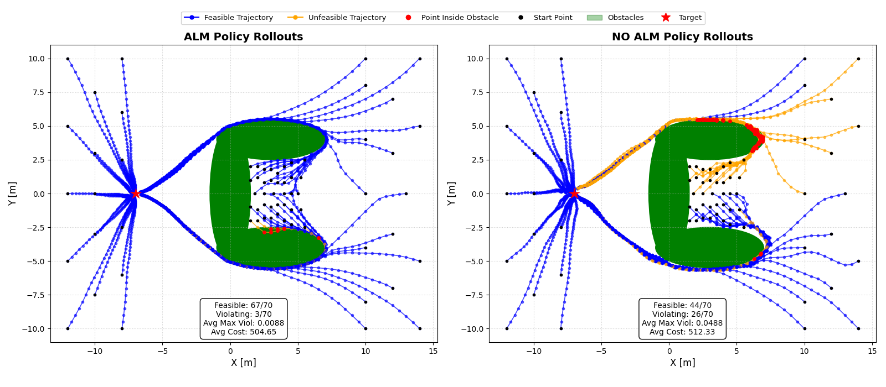
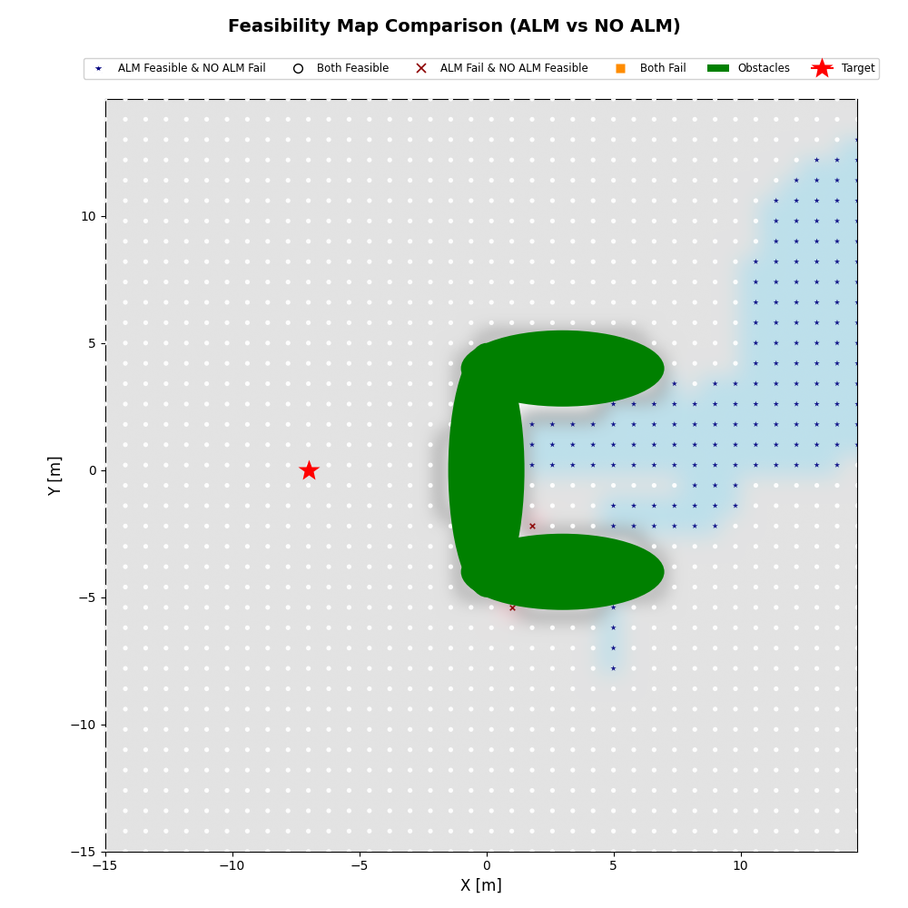
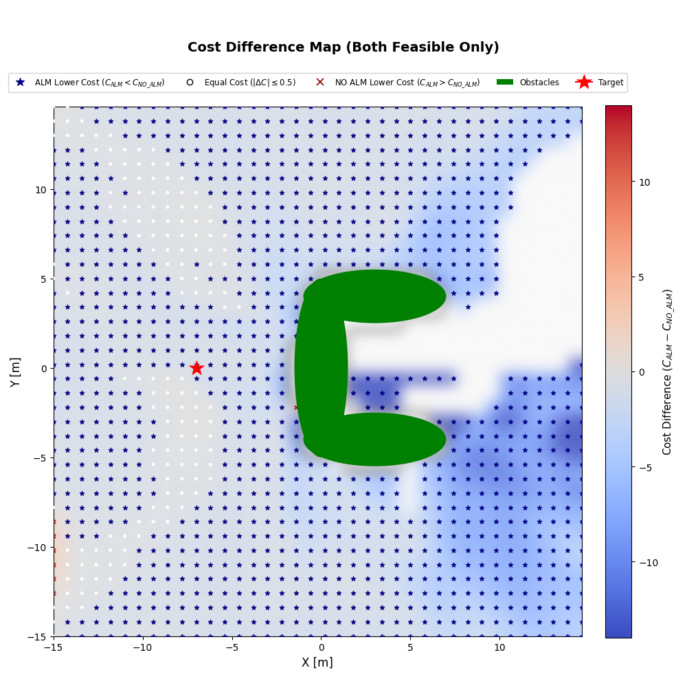
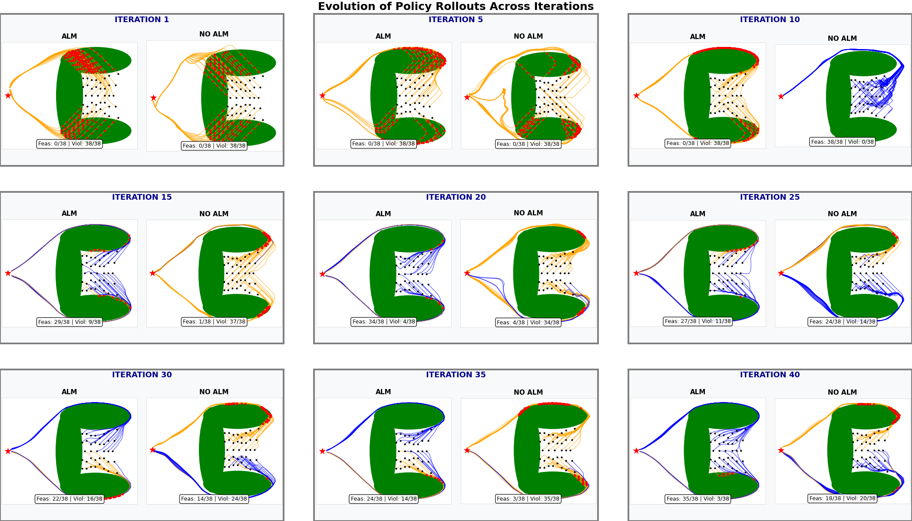
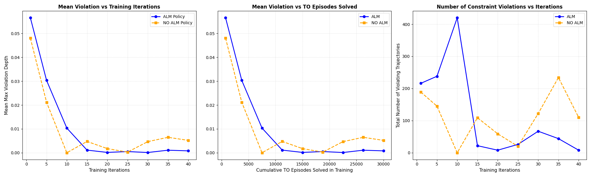
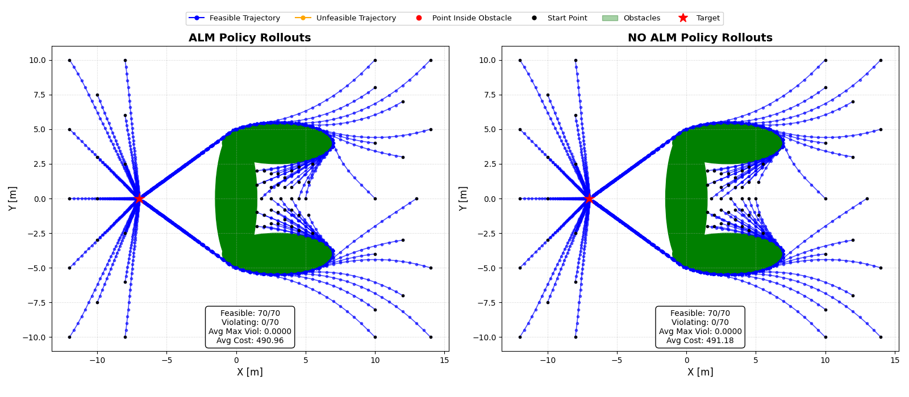
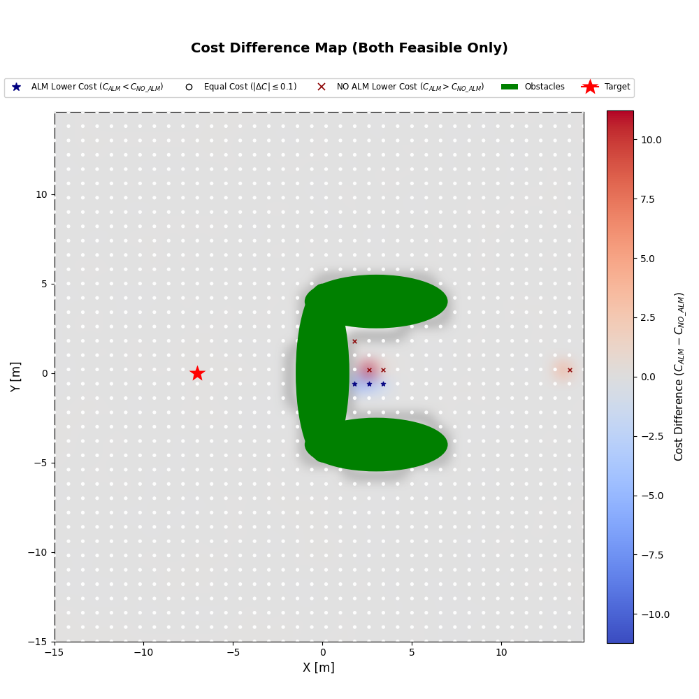
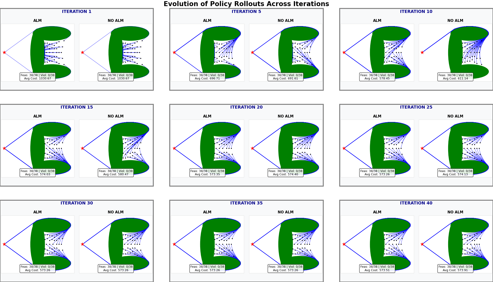
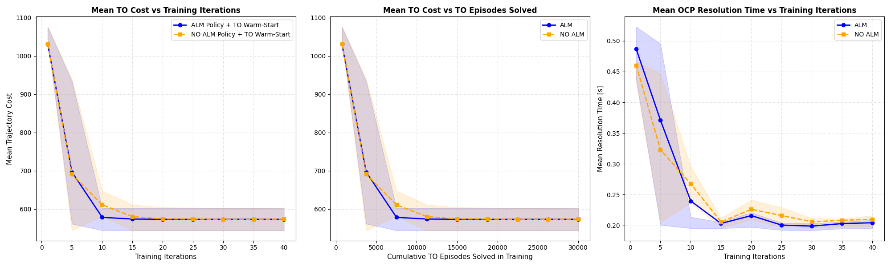

# CACTO + Augmented Lagrangian Method

Constraint-aware learning of control policies with **CACTO** (*Continuous Actor-Critic with Trajectory Optimization*), extended with an **Augmented Lagrangian Method (ALM)** to handle state constraints (obstacles) directly in actor training.

The code is a JAX/Flax re-implementation of CACTO (not 1:1 equivalent to the original algorithm). It compares two variants on a 2D single-integrator navigation problem:

| Variant | How obstacles are handled |
|---|---|
| **ALM** | Obstacles are *hard constraints* in the Trajectory Optimization (TO) problem. The actor is trained with an Augmented Lagrangian loss (Lagrange multipliers λ + quadratic penalty ρ). |
| **NO ALM** (baseline) | Obstacles are *soft penalties* in the cost function (`w_ob`). The actor minimizes the plain Q-function. |

---

## Problem setup

A point robot with single-integrator dynamics must reach a target while avoiding a **C-shaped obstacle** made of three ellipses.

- **Dynamics:** $x_{i+1} = x_i + \Delta t \, u_i$, with $x = [p_x, p_y]$ and $u = [v_x, v_y]$
- **Horizon:** $N = 50$ steps, $\Delta t = 0.05$ s
- **Control limits:** $|u| \le u_{max} = 10$ (enforced in the actor through $u = u_{max}\tanh(y)$)
- **Target:** $(-7, 0)$
- **Obstacles:** $\frac{(x - x_c)^2}{a^2} + \frac{(y - y_c)^2}{b^2} - 1 \ge 0$ for each ellipse
- **Running cost:** quadratic distance to target + log-exp "target valley" + control effort, plus a terminal cost $w_f \|x_N - x_g\|^2$

The hardest region is the area *inside the C*: a TO solver started without a good initial guess often fails there. A learned policy that gives the solver a good warm start helps the most in this region.

## Algorithm

Each CACTO iteration does the following:

1. **Trajectory Optimization:** solve a batch of OCPs (CasADi + IPOPT) from random initial states and times (40% full horizon, 60% random horizon). The first iteration starts cold. After that, the solver is warm-started with a rollout of the current actor, and falls back to a cold start if the warm-started problem fails.
2. **Replay buffer:** store the augmented states $[x, t]$ and their Monte Carlo cost-to-go $\bar V$ in a FIFO buffer that keeps about the last two iterations of data.
3. **Critic training:** regress $V_\theta(x, t)$ onto $\bar V$ with an MSE loss.
4. **Actor training:** minimize $Q(x,u) = \ell(x,u) + V_\theta(f(x,u))$.
   In the **ALM** variant the actor loss becomes
   $$\mathcal{L}_A = Q(x_t,u_t) + \boldsymbol\lambda^\top \max(0, \mathbf g(x_{t+1})) + \tfrac{1}{2}\rho\,\|\max(0,\mathbf g(x_{t+1}))\|^2,$$
   with a per-constraint dual ascent on $\lambda_j$ and a global growth of $\rho$ (driven by the worst violation) at the end of every epoch.

Main hyperparameters: 750 OCPs per iteration, actor `[256, 256, 256]`, critic `[128, 256, 256]`, ELU activations, minibatch 512, learning rates 5e-4 (actor) and 5e-3 (critic), 40 CACTO iterations.

## Repository structure

```
single_integrator/
├── single_int_ALM.ipynb                          # CACTO + ALM, step-by-step and fully documented
├── single_int_ALM_speed.ipynb                    # CACTO + ALM, faster version (parallel TO, saves models)
├── single_int_NO_AL.ipynb                        # CACTO baseline (obstacles as cost penalty)
├── single_int_NO_AL_speed.ipynb                  # baseline, faster version
├── single_int_NO_AL_speed_samplig_as_ALM.ipynb   # baseline with no initial states sampled inside obstacles
├── full_runs/                                    # notebooks with the outputs of the full 40-iteration runs
├── saved_models/
│   ├── models_ALM_40_iters/                      # actor checkpoints (iters 1, 5, 10, …, 40)
│   ├── models_NO_ALM_40_iters/
│   └── models_NO_ALM_no_sampl_in_ellips/
└── models_eval/
    ├── main_policies_eval.py       # policy rollouts + feasibility/cost heatmaps on a grid
    ├── main_policies_converg.py    # constraint violations across training iterations
    ├── main_TO_eval.py             # TO warm-started by each policy: rollouts + grid comparison
    ├── main_TO_cost_converg.py     # TO cost and solve time across training iterations
    ├── utilities/                  # parameters, OCP solver, actor network, helpers, plotting
    └── images/                     # generated figures
```

Saved actors are `.pkl` files that contain the network parameters, the architecture config and training statistics (TO episodes, critic and actor updates). Load them with `utilities.functions.load_actor`.

## Installation

The notebooks are stored with **Git LFS**, so install it before cloning:

```bash
git lfs install
```

```bash
git clone https://github.com/AleRossiS/Tesi_Repo_Git.git
```

```bash
pip install "jax[cpu]" flax optax casadi numpy matplotlib tqdm jupyter
```

The code forces JAX to run on the CPU (`CUDA_VISIBLE_DEVICES=""`).

## Usage

**Training:** open one of the notebooks in `single_integrator/` and run it top to bottom. The `*_speed` notebooks are the ones used for the full runs and save actor checkpoints to `saved_models/`.

**Evaluation:** the scripts use paths relative to the folder that *contains* the repository, so run them from there:

```bash
cd ..   # parent directory of Tesi_Repo_Git
```

```bash
python Tesi_Repo_Git/single_integrator/models_eval/main_policies_eval.py
```

The other scripts (`main_policies_converg.py`, `main_TO_eval.py`, `main_TO_cost_converg.py`) run the same way. Problem parameters (obstacles, cost weights, test initial states) are in `models_eval/utilities/parameters.py`.

## Results

All figures are in [`single_integrator/models_eval/images/`](single_integrator/models_eval/images/).

### Policy rollouts (after 40 iterations)

Rollouts of the two actors from 70 test initial states (outside the C, inside the C, and on the far side of the obstacle):



| | ALM | NO ALM |
|---|---|---|
| Feasible trajectories | **67 / 70** | 44 / 70 |
| Average max violation | **0.0088** | 0.0488 |
| Average cost | **504.65** | 512.33 |

The ALM policy hugs the obstacle boundary without crossing it. The penalty-based policy cuts through the upper and lower ellipses on many trajectories.

### Feasibility and cost over the state space

Both policies are rolled out from every point of a grid over the state space.

**Feasibility map:** for each grid point, it shows whether each policy's rollout is feasible (does not collide with the obstacles). The ALM policy gives more feasible points, mostly inside the C and on the far side of the obstacle. There the NO ALM policy fails and the ALM one succeeds. The opposite case almost never happens.



**Cost map:** it shows the cost difference $C_{ALM} - C_{NO\,ALM}$ between the two rollouts. The white, non-dotted area has no result, because at least one of the two policies gives an infeasible trajectory there. Where both are feasible, the ALM policy almost always has the lower cost.



### Constraint violations during training

Rollouts of the actor checkpoints 1, 5, …, 40 from the 38 initial states inside the C obstacle (`INITIAL_STATES_HARD`):



The metrics below are computed on the same 38 initial states:



After about 15 iterations, the ALM policy's mean violation goes to roughly zero and stays there. The NO ALM policy's violations rise again in later iterations.

### Policy as a TO warm start

Here the actor rollouts are used as the initial guess for the TO solver (CasADi + IPOPT), which then solves the full constrained OCP.



**Cost map:** each grid point shows the cost difference of the TO solutions warm-started by the two policies from that initial state. The two warm starts lead the solver to the same solution almost everywhere. Only a few points inside the C differ.



**Across training iterations:** rollouts and metrics are computed from the 38 initial states inside the C. The bands show the 1st and 3rd quartiles.




Both variants reach a similar final trajectory cost (about 575). The ALM policy gets there in fewer iterations (about 10 vs 15) and gives a slightly lower OCP solve time (about 0.20 s vs 0.21 s).

## References

- G. Grandesso, E. Alboni, G. P. R. Papini, P. M. Wensing, A. Del Prete, *"CACTO: Continuous Actor-Critic with Trajectory Optimization — Towards Global Optimality"*, IEEE Robotics and Automation Letters, 2023.
